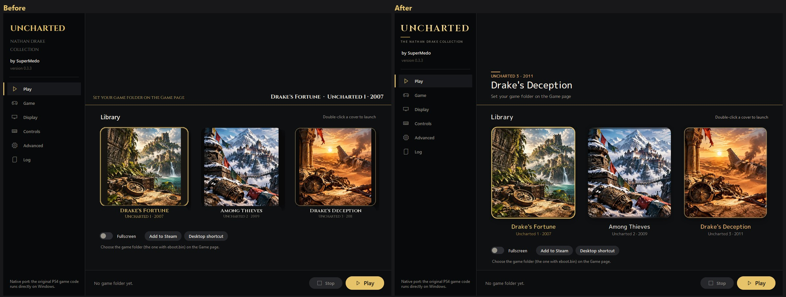
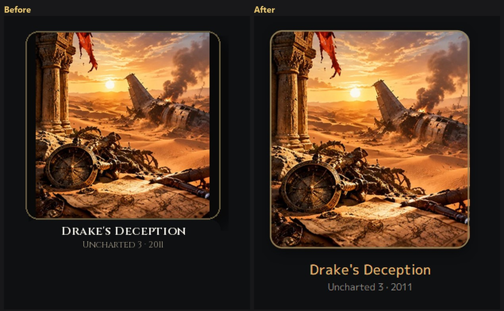
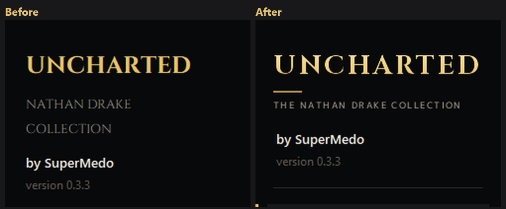
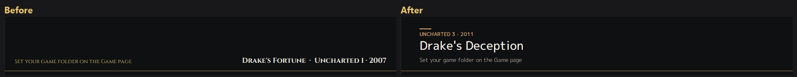
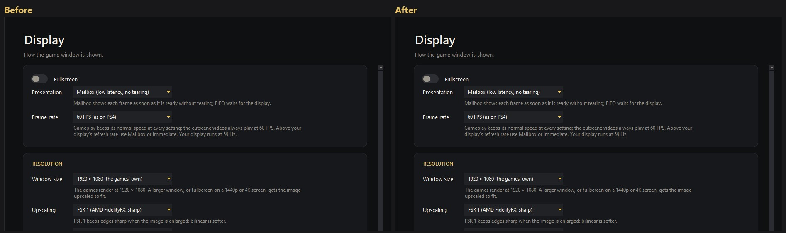

# Launcher UI polish: change log

Branch: `launcher-ui-polish`, based on `68c8cf9` (0.3.3: Intel fix, video memory note).

This branch changes the Windows launcher only (Tkinter, `launcher/`). The engine (`bb-probe`), `run.py` and the preparation scripts are untouched. No game assets, covers, music or videos are included: everything media-related plays the player's **own** files from the `art` folder, which is already in `.gitignore` and kept by updates.

## Before and after

Both sides run with only the default covers bundled in the repository, with Drake's Fortune selected and the pointer on Drake's Deception. "Before" is `68c8cf9`, "after" is this branch. Full-size single shots are in [`screenshots/`](screenshots/).

**Play page:** store-style header block with the hovered game's accent, logo-style heading, cover-shaped tiles, sharp names.

**Cover tile (2× zoom):** smooth corners and ring, soft shadow instead of an offset block, no caption notch, ClearType names in M PLUS 1p, accent colour on hover.

**Sidebar heading (2× zoom):**

**Header:**

**Display page section headings** (M PLUS 1p instead of small Cinzel):

The hover background, music and video need a player's own files, so they aren't shown here.

## Summary

| # | Change | Main files |
|---|---|---|
| 1 | Sharp game names (system text instead of text drawn into pictures) | `uncharted_launcher.py`, `uncharted_art.py` |
| 2 | PS3-style font (M PLUS 1p, OFL) for game names and headings | `uncharted_fonts.py`, `uncharted_launcher.py`, `fonts/` |
| 3 | Logo-style sidebar heading | `uncharted_art.py`, `uncharted_launcher.py` |
| 4 | Per-game accent colours | `uncharted_launcher.py` |
| 5 | Store-page header layout | `uncharted_launcher.py` |
| 6 | Play page rebuilt as one canvas ("stage") | `uncharted_launcher.py` |
| 7 | Per-game background picture on hover | `uncharted_launcher.py`, `uncharted_art.py` |
| 8 | Cover tiles: cover-shaped, smooth corners, soft shadow | `uncharted_art.py`, `uncharted_launcher.py` |
| 9 | Hover music per game | `uncharted_media.py` (new), `uncharted_launcher.py` |
| 10 | Hover video inside the cover | `uncharted_media.py`, `uncharted_launcher.py` |
| 11 | Header background video | `uncharted_media.py`, `uncharted_launcher.py` |
| 12 | PS3 XMB files (`ICON1.PAM`, `SND0.AT3`, `PIC1.PNG`) | `uncharted_media.py`, `uncharted_art.py` |
| 13 | Packaging: PyAV for video and music | `packaging/windows/package.sh` |
| 14 | Player documentation for the `art` folder | `packaging/windows/README-Uncharted.txt` |

## Files affected

| File | Status | What changed |
|---|---|---|
| `launcher/uncharted_launcher.py` | modified | Fonts, heading, accents, header, Play page stage, cover tiles, hover background, music and video, media lifecycle |
| `launcher/uncharted_art.py` | modified | Heading renderer, smooth masks and rings, transparent cover-shaped tiles, blurred-strip fit, game backgrounds |
| `launcher/uncharted_fonts.py` | modified | Docstring lists both bundled fonts |
| `launcher/uncharted_media.py` | **new** | Media lookup, video decoding, music playback with fades, PS3 file support |
| `launcher/fonts/MPLUS1p-Regular.ttf` | **new** | M PLUS 1p Regular (SIL Open Font License 1.1) |
| `launcher/fonts/MPLUS1p-Medium.ttf` | **new** | M PLUS 1p Medium (SIL Open Font License 1.1) |
| `launcher/fonts/OFL-MPLUS1p.txt` | **new** | The font's license, as the OFL requires |
| `packaging/windows/package.sh` | modified | Installs PyAV, hidden imports `uncharted_media` and `av` |
| `packaging/windows/README-Uncharted.txt` | modified | Lists the new `art` folder files |

---

## 1. Sharp game names

**Problem:** the names under the covers ("Drake's Fortune", "Uncharted 1 · 2007") looked blurry. They were painted into the cover bitmap with Pillow at 12–18 px, which uses grey-scale anti-aliasing and skips Windows ClearType.

**Implementation:**
- `poster_tile()` (`uncharted_art.py`) takes a new `caption=<pixels>` argument. With it, the caption strip is reserved but left empty, and the picture reports where it is in `image.info['caption']` (and the poster area in `image.info['poster']`).
- `draw_card()` (`uncharted_launcher.py`) writes the names with `Canvas.create_text()`, so Windows renders them with ClearType at any size.
- Colours: the selected game in gold, the hovered game in its accent (see 4), others in soft white `#e4ded2`. Subtitles are muted.

## 2. PS3-style font

**Problem:** Cinzel (roman capitals) was used for small text too, which reads poorly at small sizes. The goal was the PS3 XMB look.

**Implementation:**
- The PS3 system font (Rodin) and the PS4/PS5 font (SST) are proprietary. **M PLUS 1p** (Google Fonts, SIL OFL 1.1) is a free, close-looking sans. Its Regular and Medium weights are bundled in `launcher/fonts/` with its license.
- `load_fonts()` registers them privately for the process with `AddFontResourceExW(..., FR_PRIVATE)`, as was already done for Cinzel. GDI exposes the Medium weight as its own family, `M PLUS 1p Medium`. If the files are missing it falls back to Segoe UI.
- New font roles: `font_game` (cover names), `font_game_sub`, `font_hero` (header title, 21 pt), `font_hero_sub`, `font_eyebrow` (header series line).
- The `Section.TLabel` style (section headings on the Game, Display, Controls and Advanced pages) moves from Cinzel Bold to M PLUS 1p Medium.
- If a caller still asks `poster_tile()` to draw the names into the picture, it uses M PLUS 1p too.
- Cinzel stays for the brand heading (see 3), where its logo-like capitals fit.

## 3. Logo-style sidebar heading

**Problem:** "UNCHARTED / NATHAN DRAKE / COLLECTION" were three plain labels. Tk cannot space letters out, so the heading looked flat.

**Implementation:**
- `brand_heading(width, dpi)` in `uncharted_art.py` renders the heading with Pillow:
  - "UNCHARTED" in Cinzel Bold with 10 % letter spacing, filled with a vertical gold gradient (via a text mask). The size is fitted to the sidebar width.
  - A short gold rule under it.
  - "THE NATHAN DRAKE COLLECTION" in M PLUS 1p Medium small capitals with 16 % letter spacing, fitted to the title's width.
- Helpers `_tracked()` and `_tracked_width()` draw and measure letter-spaced text.
- `build()` shows it as an RGBA `PhotoImage` in a label. If Pillow or the fonts are unavailable it falls back to two text labels.
- It is rendered at the screen's DPI scale, so it stays sharp. Large text doesn't suffer the small-size blur from 1.

## 4. Per-game accent colours

**Implementation:**
- `GAME_ACCENTS = {'u1': '#a9cb86', 'u2': '#a6cbe2', 'u3': '#e8b06a'}`: jungle green (Drake's Fortune), Himalayan ice (Among Thieves), desert sand (Drake's Deception).
- Used for the header's series line and the rule above it (5), and for the hovered cover's name (1).
- The selected game keeps the launcher's gold, so "selected" and "hovered" stay distinct.

## 5. Store-page header layout

**Before:** a status line bottom-left, and the game's title and subtitle bottom-right.

**After:** one left-aligned block, on the same left edge (44 px) as the "Library" heading below it:

1. a 28 px rule in the game's accent,
2. the series line in capitals and the accent colour ("UNCHARTED 2 · 2009"),
3. the title in 21 pt M PLUS 1p Medium,
4. the folder status ("CUSA… · version …" or "Set your game folder on the Game page").

All header text goes through `shadow_text()`, which draws a black copy 1 px below and right, so it stays readable over bright backgrounds. "Library" uses M PLUS 1p Medium as well.

## 6. Play page rebuilt as one canvas

**Why:** a background picture behind the header, the library heading and the covers isn't possible with separate Tk frames, because frames are opaque.

**Implementation (`uncharted_launcher.py`):**
- `build_play()` now creates one `Canvas`, `self.stage`, for the header, the library heading and the three covers. The Fullscreen, Add to Steam and Desktop shortcut row and the "ready" line stay ordinary widgets below it, packed at the bottom of the page where the background has faded out.
- `draw_stage()` lays everything out on each resize or change:
  - header height at the banner's 16:9 ratio, clamped to 180–280 px,
  - three columns as the old grid had them (36 px margins, 18 px gaps),
  - tile height from the cover shape, limited so the names stay on screen.
- Covers are canvas images. Hit testing uses the stage's `<Motion>`, `<Leave>`, `<Button-1>` and `<Double-Button-1>` with `card_at(x, y)` and `pick_card()`, so moving between a cover's picture and its name doesn't flicker the hover state. The cursor turns into a hand over covers.
- `refresh()` calls `draw_stage()`.
- Removed: `fit_posters()`, `_sync_hero_height()`, `draw_hero()` and the per-card canvases.
- `scaled_art()` now takes the height as a parameter instead of reading the old header canvas.

## 7. Per-game background picture on hover

**Behaviour:**
- When the launcher opens, the header shows the plain banner: `collection_banner.jpg`, else the dump's `sce_sys/pic1.png`, else empty, plus the header video if one exists (see 11).
- Hovering a cover replaces it with that game's background picture across the top of the page, a little more than half its height (62 %), fading into the page colour.
- The background **stays** after the pointer leaves, until another game is hovered (`self.backdrop_key`).

**Implementation:**
- `game_backdrop(key, width, height, page)` (`uncharted_art.py`):
  - scales the picture to cover the area, focused at 30 % from the top so faces stay in view,
  - darkens it 22 %,
  - fades it into the page colour with a smoothstep from 42 % of its height to the bottom.
- `_game_background(key)` finds `art/u1_background.jpg` (also `.jpeg`, `.png`, `.webp`), else a PS3 `art/u1/PIC1.PNG`, and caches it in `_BACKGROUNDS`.
- `photo_backdrop()` (launcher) caches one `PhotoImage` per game and window size, so moving between covers is instant. The cache clears when the window size changes.
- While a game background shows, the header video is paused (`sync_hero_video(..., hidden=True)`) and the gold rule under the header is left out.

## 8. Cover tiles

**Problems:**
- Covers whose shape didn't match the tile showed flat black strips beside them.
- The drop shadow was offset as a second dark block beside the corners.
- The caption plate made a notch under the cover.
- Corners and the selection ring had jagged edges.

**Implementation:**
- **Cover-shaped tiles.** `poster_aspect(key)` returns the cover picture's width/height. `draw_card()` narrows the tile so the poster area matches it, and the picture fills the tile whole with nothing cropped. The painted fallback scenes keep the full column width.
- **No flat strips.** `_fit()` fills any remaining strips with a darkened, blurred copy of the picture instead of black. This is now only a fallback, since 2:3 covers fill their tiles exactly.
- **Transparent tiles.** `poster_tile(..., transparent=True)` returns RGBA, so the stage background shows around a cover. It also leaves out the caption plate; the names sit on the page.
- **Smooth corners.** `rounded_mask()` (renamed from `_rounded_mask`, now public) draws at 4× size and reduces with Lanczos. The selection ring and hover outline use the new `_ring()`, drawn the same way.
- **Soft shadow.** A single rounded shadow sits straight under the cover (2 px in, 5 px down) with a Gaussian blur, instead of an offset, larger block.

## 9. Hover music per game

**Behaviour:** resting the pointer on a cover for 350 ms fades in that game's music over 700 ms, at 70 % volume. Moving to another cover fades the old track out while the new one is prepared. Leaving the covers fades it out. Music stops away from the Play page, when a game starts, and on close.

**Files:** `art/u1_music.*`, `u2_music.*`, `u3_music.*` (`.mp3`, `.ogg`, `.opus`, `.flac`, `.m4a`, `.aac`, `.wav`, `.at9`, `.at3`), or a PS3 `art/u1/SND0.AT3`.

**Implementation (`uncharted_media.py`, class `HoverMusic`):**
- Playback uses the standard library's `winsound.PlaySound(..., SND_ASYNC | SND_LOOP)`, so playing needs no extra dependency. It only plays PCM WAV, so `_cached_wav()` decodes each track once with PyAV into 16-bit stereo 44.1 kHz WAV, capped at 10 minutes. The cache is `%APPDATA%\uncharted-launcher\media-cache\`, keyed by a SHA-1 of the path, size and modification time. Decoding runs on a helper thread, and the Tk side polls for the result.
- Fades step `waveOutSetVolume()` (`winmm`) for the process over 14 steps with `after()`.
- Without PyAV, only PCM `.wav` music plays.
- All calls happen on the Tk thread; `_card_hover()` drives it.

## 10. Hover video inside the cover

**Behaviour:** hovering a cover plays that game's video inside it, PS3 style. The clip keeps its original wide (16:9) shape across the middle of the cover, with the cover itself darkened above and below it, all inside the cover's rounded corners. The cover shows until the first frame arrives. The video stops when the pointer leaves, a game starts, the page changes or the launcher closes. Videos play muted, because the music is separate (9).

**Files:** `art/u1_video.*`, `u2_video.*`, `u3_video.*` (`.mp4`, `.webm`, `.mkv`, `.mov`, `.m4v`, `.avi`, `.pam`), or a PS3 `art/u1/ICON1.PAM`.

**Implementation:**
- `VideoClip` (`uncharted_media.py`):
  - decodes with PyAV on a helper thread in real time, paced by the frames' timestamps,
  - loops at the end,
  - drops frames that are more than 250 ms late rather than drifting,
  - hands only the newest picture to Tk through a one-slot queue.
  - `pause()`, `resize()`, `stop()` and `latest()` control it.
- Two ways of fitting:
  - `cover=True` fills the box, trimming the edges. Used for the header.
  - `cover=False` shows the whole clip over `fill(size)` when given (here the dimmed cover from `dimmed_cover()`), otherwise over a blurred, darkened fill made from the clip itself, with feathered edges.
  - Clips too small to fill a box sharply (under 60 % of its width) always use the second way.
- Launcher side:
  - `draw_tile_clip()` starts the clip for the hovered cover at the poster area's size (`image.info['poster']`).
  - `pump_tile_clip()` pastes the newest frame into an RGBA `PhotoImage` every 15 ms.
  - `round_clip()` applies the cover's smooth rounded mask on the decoding thread.
  - `stop_tile_clip()` ends it.
- Tip for players: a 1080p clip shown about 250 px wide decodes more work than needed. A 480p copy (H.264, no audio) is a tenth of the size and plays the same.

## 11. Header background video

`art/background.*` plays looped in the header while no game background is shown. The same `VideoClip` (cover mode) is passed through `shade_video()`, which darkens each frame 22 % and fades its lower part into the page so the header text stays readable. It's paused away from the Play page, while a game runs, and while a game background covers the header.

## 12. PS3 XMB files

For players who own the PS3 discs, the files the XMB itself uses can be copied as they are from `PS3_GAME/` into `art/u1/` (and `u2/`, `u3/`):

| PS3 file | Used as | How |
|---|---|---|
| `PIC1.PNG` | background picture (7) | read by Pillow |
| `ICON1.PAM` | video inside the cover (10) | `playable_video()`: a PAMF file is an MPEG program stream behind Sony's own header (usually 0x800 bytes). The stream from its first pack start code (`00 00 01 BA`) is cached as `.mpg`, which FFmpeg reads. Its small 320×176 picture is shown whole, never stretched soft. |
| `SND0.AT3` | music (9) | ATRAC3/ATRAC3plus, decoded by FFmpeg's `atrac3` / `atrac3plus` decoders |

Named files (`u1_video.mp4` etc.) take priority over PS3 files. `find_ps3()` accepts upper- or lower-case names.

Tested with stand-in files of the same layout, **not** with real disc files.

## 13. Packaging

`packaging/windows/package.sh`:
- installs `av` (PyAV) next to PyInstaller and Pillow in the build venv,
- adds `uncharted_media` and `av` to the hidden imports.

PyAV ships its own FFmpeg, which adds about **75 MB** to the packaged launcher (about 40 MB to 117 MB). Without PyAV the launcher still works: video stays off and only `.wav` music plays. If that size is too much, PyAV could become an optional download.

## 14. Player documentation

`packaging/windows/README-Uncharted.txt` (shipped as `README.txt`): the "Your own covers" entry now lists the per-game background, music and video files, `background.mp4` and the PS3 files.

---

## Art folder reference (player files, never in the repository)

Next to `Uncharted.exe` (frozen) or in `launcher/art/` (from source):

| File | Purpose |
|---|---|
| `u1.jpg`, `u2.jpg`, `u3.jpg` | Cover pictures (any shape; the tile follows it) |
| `collection_banner.jpg` | Header picture while no game is hovered |
| `u1_background.jpg` … | Game background on hover (also `.jpeg`, `.png`, `.webp`) |
| `u1_music.mp3` … | Music on hover |
| `u1_video.mp4` … | Video inside the cover on hover |
| `background.mp4` | Header video while no game is hovered |
| `u1/PIC1.PNG`, `u1/ICON1.PAM`, `u1/SND0.AT3` … | PS3 disc files, used when the named files are missing |

## How it was checked

- The launcher was run from source with a throwaway settings folder and screenshotted: with the default bundled covers, with stand-in videos and music, and with full player art.
- The frozen `Uncharted.exe` (PyInstaller, Python 3.14, PyAV 19) was built and run the same way, including video playback.
- Music decoding was checked on three MP3 tracks (2–3.5 minutes, each decoded in about 1 s), and the `waveOutSetVolume` calls returned success. The sound itself wasn't listened to in testing.
- PS3 `ICON1.PAM` was checked with a synthetic PAMF-layout file, and `SND0.AT3` only for lookup and conversion with a PCM stand-in. FFmpeg's ATRAC decoders are present, but no real disc files were available.

## Known limitations

- PyAV adds about 75 MB to the package (13).
- Background switches are instant (no cross-fade), and hover videos restart from the beginning on each hover.
- Music volume uses the process's waveOut volume, so it also scales any other sound the launcher plays.
